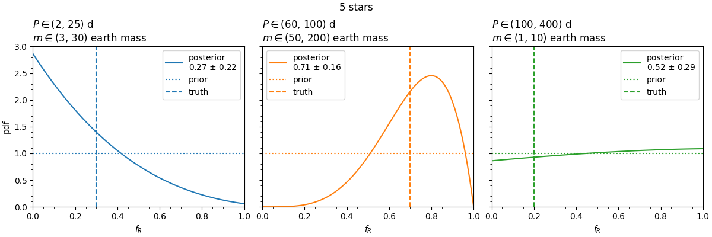

<p align="center">
  
</p>
<h2 align="center">
planet occurrence rates from radial velocities
</h2>

This repository contains an implementation of the method described in [Faria,
Delisle, and Ségransan
(2025)](https://ui.adsabs.harvard.edu/abs/bibcode/abstract) for the calculation
of planet occurrence rates from radial-velocity observations. If you use this
code, please cite the paper.

The method is simple, and so is the code.  
This implementation uses results obtained with the [**kima**
package](https://github.com/kima-org/kima) and requires that it is installed.

### Usage

The file `box.py` defines a class `Box` that represents the region in orbital
period and planetary minimum mass for which the planet occurrence rate is
calculated.

```py
>>> Box((2, 25), (3, 30))
Box(period_limits=(2, 25), mass_limits=(3, 30), true_fraction=None, units='earth')
```

This class contains only two methods:

- `calculate_f0`: calculates the prior probability for "at least one planet in
  the box", denoted by $f_0$ in the paper, using Monte Carlo. It takes as
  arguments a `KimaResults` object that provides the priors used in the RV
  analysis and, optionally, the stellar mass in solar masses.

- `fraction_inside`: calculates the fraction of posterior samples inside the
  box, taking the same arguments. 


The file `occurrence.py` defines a class `occurrence` which calculates the
posterior distribution for the planet occurrence rate in a given box. It accepts
as arguments a list of `KimaResults` objects and one or more `Box` objects. The
class has two interesting methods:

- `estimate_posterior`: calculates the posterior distribution for the planet
  occurrence rate in each box, assuming a uniform prior.

- `posterior_mean_std`: calculates the mean and standard deviation of the 
  posterior distribution for each box.


### Example 

Inside the folder `results5` are some example results obtained with **kima**. These
correspond to the analysis of the first 5 synthetic datasets presented in the
paper. 

<details><summary>To load these results</summary>

```py
from glob import glob
from multiprocessing import ThreadPool

import kima

with ThreadPool(5) as pool:
    results = pool.map(kima.load_results, glob('results5/*'))
```

</details>

To calculate the posterior for the planet occurrence rates in the same regions
as defined in the paper, use the following code:


```py
>>> R1 = Box((2, 25), (3, 30), true_fraction=0.3)
>>> R2 = Box((60, 100), (50, 200), true_fraction=0.7)
>>> R3 = Box((100, 400), (1, 10), true_fraction=0.2)

>>> O = occurrence(results, [R1, R2, R3])
>>> O.estimate_posterior()
```

which will reproduce the results shown in Figure 3:

```py
>>> O.plot()
```

